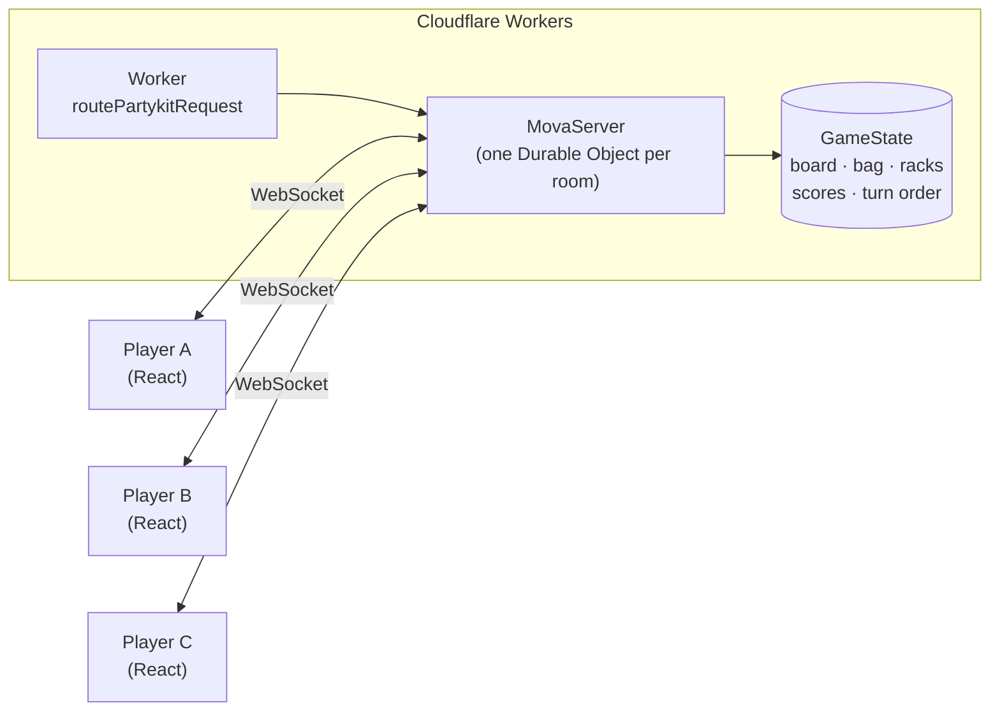
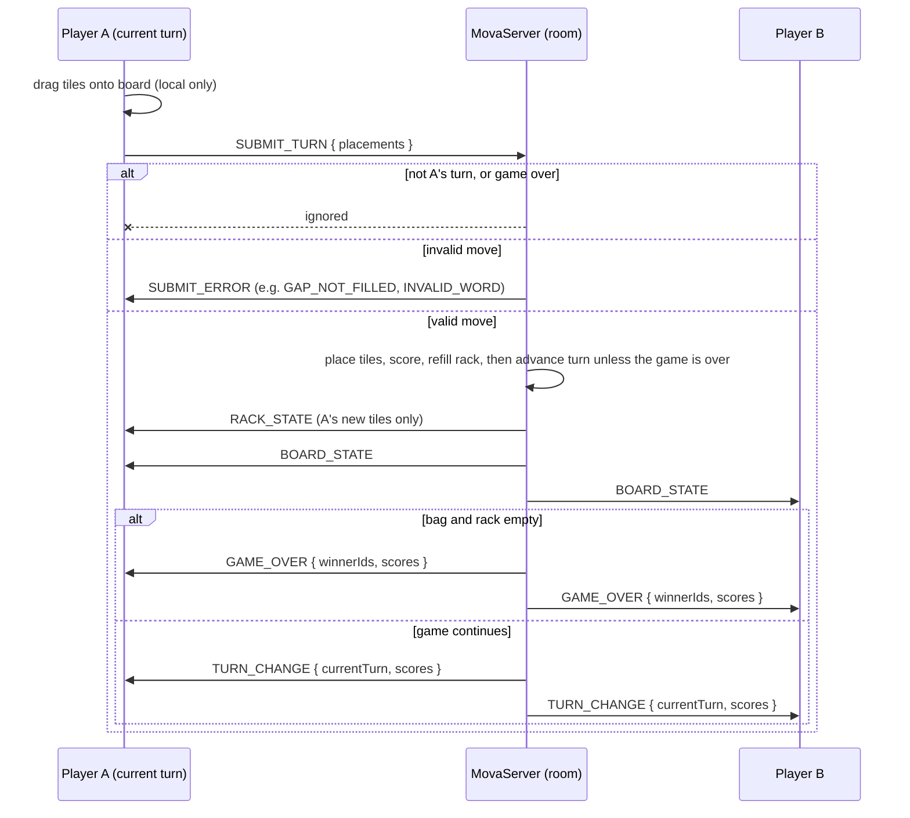

# mova

**[Play the live demo → mova-1l9.pages.dev](https://mova-1l9.pages.dev/)**

A real-time multiplayer word tile game for 2–4 players. Create a room, send the link to friends, and play a Scrabble-style game in the browser, with no account and no install. Every move is checked on the server: tile placement, connection to the board, and every word formed is looked up in the SOWPODS dictionary, so the other players see a move only once it is legal.

<!-- TODO: add a GIF of two browser windows playing the same room -->

[](https://github.com/ImDarkly/mova/actions/workflows/ci.yml)

## Tech stack

| Layer       | Technology                                                    |
| ----------- | ------------------------------------------------------------- |
| Frontend    | React 19, TypeScript, Vite                                    |
| Styling     | Tailwind CSS v4, shadcn/ui                                    |
| Drag & drop | dnd-kit (mouse, touch and keyboard)                           |
| Realtime    | PartyServer (WebSockets on Cloudflare Workers + Durable Objects) |
| Routing     | React Router v7                                               |
| i18n        | i18next                                                       |
| Tests       | Vitest (game logic), Playwright (UI regressions)              |

## How realtime sync works

Each room is one PartyServer instance, which Cloudflare runs as a **Durable Object**: a single-threaded object with one address per room code. Every player in a room connects to the same instance over a WebSocket.

- **The server is the only source of truth.** It owns the bag, every rack, the board, scores and turn order (`party/lib/gameState.ts`). Clients never change game state themselves; they send an intent (`SUBMIT_TURN`) and render whatever state the server sends back.
- **Tiles you are placing are local until you submit.** Dragging tiles onto the board only changes local React state (`useTileAssignment`). Other players see nothing until the server accepts the move.
- **Moves are validated and applied atomically.** The server checks the geometry, the rack indexes and every word formed _before_ it touches the board. A rejected move sends `SUBMIT_ERROR` to that player only, and nothing changes for anyone else.
- **Racks are private.** The server sends `RACK_STATE` only to the rack's owner; everyone else just sees scores and the board.



### One turn, end to end



### Conflicts

The game is turn-based, so there is no merging of concurrent edits. The server drops any `SUBMIT_TURN` from a player whose turn it isn't. Because a Durable Object handles one message at a time, two messages that arrive together are processed one after the other, never interleaved.

### Reconnects

Each browser keeps a stable client id in `localStorage` and uses it as its connection id. When a player drops mid-game, the server keeps their seat, rack and score and marks them `connected: false`; if it was their turn, the turn passes to the next connected player. When they come back with the same id, the server sends them their rack, the board, the current turn and scores, and tells everyone else they are back. New players cannot join a game in progress.

### Messages

| Direction       | Message             | When                                    |
| --------------- | ------------------- | --------------------------------------- |
| client → server | `READY` / `UNREADY` | Player toggles ready in lobby           |
| client → server | `SUBMIT_TURN`       | Player submits placed tiles             |
| client → server | `SKIP_TURN`         | Player passes                           |
| server → client | `ROOM_STATE`        | Player joins, leaves, readies, reconnects |
| server → client | `GAME_START`        | All players ready (or on reconnect)     |
| server → client | `RACK_STATE`        | Game start, after own turn, reconnect   |
| server → client | `BOARD_STATE`       | After each valid turn, reconnect        |
| server → client | `TURN_CHANGE`       | After each turn, skip or disconnect     |
| server → client | `SUBMIT_ERROR`      | Invalid placement or word               |
| server → client | `ROOM_FULL`         | Room has 4 players or game has started  |
| server → client | `GAME_OVER`         | Bag empty and a player's rack empty     |

### Key files

```
party/
  index.ts              PartyServer entry: onConnect, onClose, onMessage
  lib/gameState.ts      All game rules as a plain class with no I/O (easy to test)
  lib/validation.ts     Placement rules (line, gaps, connectivity) + dictionary
  lib/wordExtraction.ts Finds every word a move forms and scores it
  lib/turns.ts          Turn order that skips disconnected players
  lib/bag.ts            Tile bag: build, shuffle (crypto RNG), draw, refill

src/
  hooks/game/useGameSession.ts    WebSocket connection + game state
  hooks/room/useRoomSession.ts    WebSocket connection + lobby state
  hooks/game/useTileAssignment.ts Local drag state: rack ↔ board
  pages/Game.tsx                  Game screen, drag context, submit
  pages/Room.tsx                  Lobby screen
```

## Run it locally

**Prerequisites:** Node.js 22+, npm

```bash
npm install
npm run dev:all     # Vite on localhost:5173 + Wrangler/PartyServer on localhost:1999
```

Open `http://localhost:5173` in a normal window and a private window (or two browser profiles) to play against yourself. Two windows in the same profile share `localStorage`, so they would share one player id and one seat.

## Tests

```bash
npm test            # game-logic unit tests (Vitest), no server needed
npm run test:ui     # browser regression tests (Playwright)
npm run verify      # lint + typecheck + unit tests + build, same as CI
```

The unit tests in `party/lib/*.test.ts` cover placement validation, word extraction and scoring, and the game state: rejected moves leave the board untouched, valid moves score and pass the turn, and disconnected players keep their seat.

The UI tests start their own Vite server and use fixed WebSocket responses, so no PartyServer instance is needed. They cover accepted and rejected submissions, repeated same-player turns, leave confirmations, short-screen scrolling, accessible room labels, and keyboard placement. On Windows they use installed Google Chrome; elsewhere run `npx playwright install chromium` first.

## Features

- Create a room and share a 6-character link, copied to the clipboard for you
- Join via the shared link or by typing the room code
- Lobby with player list and ready toggle; the game starts when everyone is ready
- 15×15 board with premium squares marked and a centre star
- 7 private tiles per player, refilled from the bag after each turn
- Drag tiles from rack to board (or place them with the keyboard), drag back or Clear to undo
- Server-side validation of placement and dictionary words, with a specific error for each case
- Live turn indicator and scores for all players
- Game over screen with winner, tie, and final scores

## Roadmap

- Premium squares counted in scoring (they are shown on the board, not scored yet)
- Blank tiles that let the player pick a letter
- Tile swap
- Persist room state to Durable Object storage so a game survives a server restart
